<p align="center">
  
</p>

<h1 align="center">KBook</h1>

<p align="center">
  <strong>Let 16 AIs Debate Every Book You Read</strong>
</p>

<p align="center">
  Books deserve a cage match. Reading, unhinged.<br/>
  An open-source AI deliberation engine — we don't read for you, we think for you.
</p>

<p align="center">
  
  
  
  
  
  <a href="https://github.com/keiskeies/kbook/stargazers">
    
  </a>
</p>

<p align="center">
  <a href="./README.md">中文</a> · <a href="./README_EN.md">English</a>
</p>

<p align="center">
  <a href="#-why-kbook"><strong>Why</strong></a> ·
  <a href="#-four-core-experiences"><strong>Core Experiences</strong></a> ·
  <a href="#-four-contrarian-decisions"><strong>Contrarian</strong></a> ·
  <a href="#-feature-list"><strong>Features</strong></a> ·
  <a href="#-quick-start"><strong>Quick Start</strong></a>
</p>

---

## Why KBook?

> **The worst part of finishing a book isn't not understanding it — it's having no one to argue with.**

Almost every deep reader gets stuck at the same four walls:

| Wall | Symptom |
|------|---------|
| **① Read it, lost it** | You highlighted, you posted, two days later only the title remains. Passive input retains ~10%; active debate retains ~75% |
| **② One lens only** | The same book on positioning reads as "mindshare" to a marketer, "features" to a product person, "business model" to an investor. You taste one flavor because you have one lens |
| **③ Wisdom that never lands** | "Long-termism" and "first principles" all sound right — but how do they apply to *your* situation? Nobody helps you bridge the gap |
| **④ Book hunting like blind dating** | The algorithm always pushes bestsellers. It has no idea what stage of life you're in. Someone who just lost their job doesn't need *Zero to One* |

**KBook is built for people who truly want to understand a book.**

No reader app. No bookstore. No "read and leave" shallow features. KBook injects an entire book into a RAG vector knowledge base so the AI genuinely "reads" it — then sits with you for one-on-one deliberation, hosts a multi-role roundtable, or even stages a fiery debate between wildly different personalities.

**Closing the book isn't the end of reading — it's the beginning of thinking. Books aren't just read; they're talked through, debated, and fully understood.**

---

## 🔥 Four Core Experiences

### 1️⃣ AI Roundtable — 147 Personas, One Table, One Book Fully Explored

Reading alone is solitude; reading together is a feast.

KBook's roundtable isn't "multiple AIs chatting" — **147 personas**, each with their own way of thinking, speaking habits, values, and temperament, like a late-night reading talk show hosted just for you:

- **40 professional personas** — Philosophers interrogate premises, investors calculate ROI, poets care about the texture of language, farmers only care about land and weather
- **107 real thinkers** — From Musk, Jobs, Buffett, Munger, and Duan Yongping, to Lu Xun, Wang Xiaobo, Einstein, and Kahneman… each one isn't a style prompt, but a complete "thinking operating system": core mental models, decision heuristics, expression style, honesty boundaries

**How a discussion runs:**

1. **AI casting** — Drop in a book, the LLM picks the 4-6 personas "most fit for this table" based on its themes
2. **Host opens** — An AI host introduces the book and throws out the first topic
3. **Dynamic floor** — Not a round-robin; whoever has something to say speaks first
4. **Real collisions** — Personas rebut, supplement, go off-topic, even quarrel — genuine discursive tension, not polite noise
5. **Coverage tracking** — Real-time tracking of how much of the book the discussion covers; the host steers new topics when things go cold
6. **Insight report** — When the discussion ends, a multi-perspective structured research report is generated

**For:** Curious readers wondering "how would an investor and a poet discuss this book?"; book club organizers hunting for discussion material; social learners who can't crack a book alone and crave hearing different minds at work.

<p align="center">
  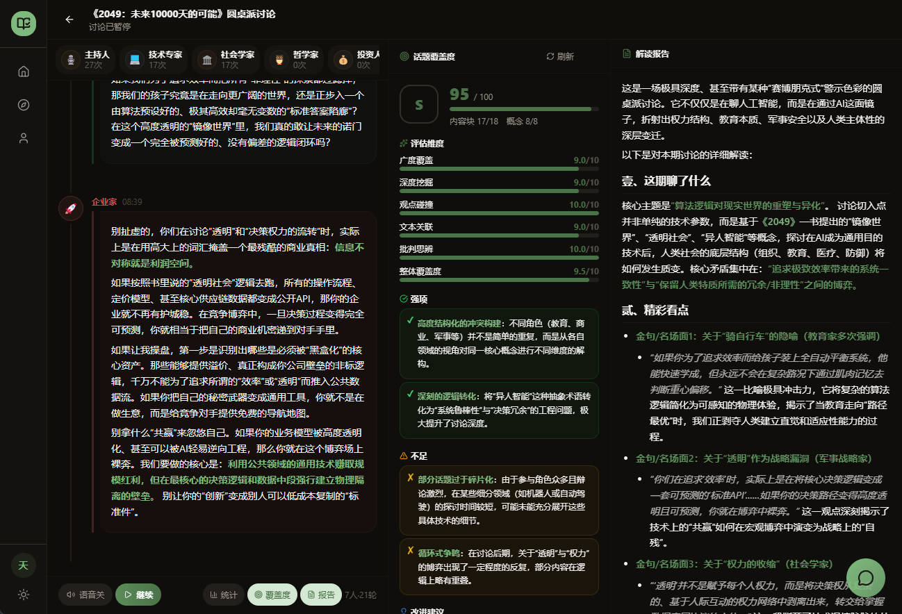
  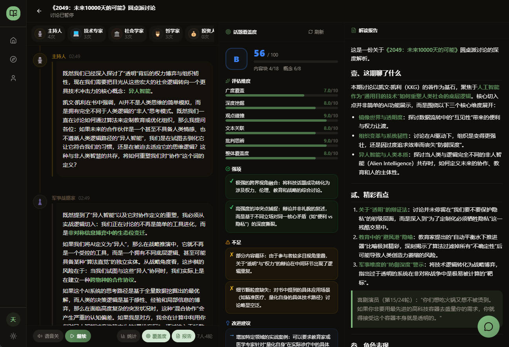
</p>

---

### 2️⃣ AI Debate — 16 Debater Personalities, One Book Debated Inside Out

This is KBook's most electrifying feature. **16 vividly distinct AI debater personalities** — Logical, Scathing, Witty, Rebellious, Philosophical, Data-Driven… — battle through a complete debate tournament around the controversial ideas in a book:

- **Personalities that leap off the screen** — The Scathing type mercilessly tears apart logical fallacies; the Witty type wraps sharp points in humor; the Data type obsesses over every link in the evidentiary chain
- **Full tournament format** — Opening arguments → Cross-examination → Free debate → Closing statements. Multi-round attack and defense, not one-shot output
- **AI judges, 7 dimensions** — Logic, evidence richness, rebuttal force,感染力 (emotional impact), humor, clarity of expression, novelty of viewpoint. Scored round by round, with detailed critique reports
- **Watch the debate, then read the book** — Many users say: "After watching the AI debate, I realized I completely misread the book the first time."

**For:** Fans of debate shows and competitive argument; rational decision-makers who want to "see how both sides fight it out" before forming an opinion; readers who feel a book "sort of makes sense but something feels off."

<p align="center">
  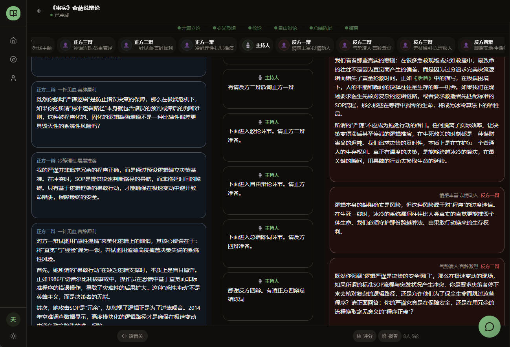
  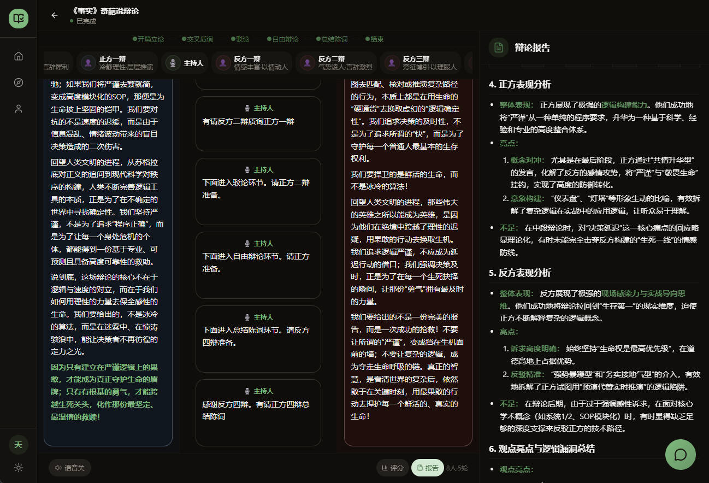
</p>

---

### 3️⃣ AI Deliberation Engine — Talk All Night with an AI That Truly "Read" the Book

The full book is chunked at 800 characters (200-character overlap) and injected into a RAG vector store, so the AI genuinely "reads" the book — but it **only analyzes, comments, extends, and contrasts. It never reproduces the original text**:

- **Cross-chapter soul-searching** — "The author's argument in Chapter 3 is self-contradicted in Chapter 5 — what do you think?" The AI retrieves across the entire book, revealing the full argumentative arc
- **Socratic dialogue** — Rather than handing you answers, it uses the book's own intellectual framework to ask layered questions, forcing out your independent thinking
- **Stress-testing viewpoints** — Throw in perspectives contrary to the author and watch the AI dismantle the logical blind spots on both sides
- **Four conversation styles** — Casual / Deep / Concise / Witty, switchable by scenario

**For:** Deep readers bursting with questions after the last page; researchers who need to fully grasp a book fast; demanding readers who want every answer grounded in evidence.

<p align="center">
  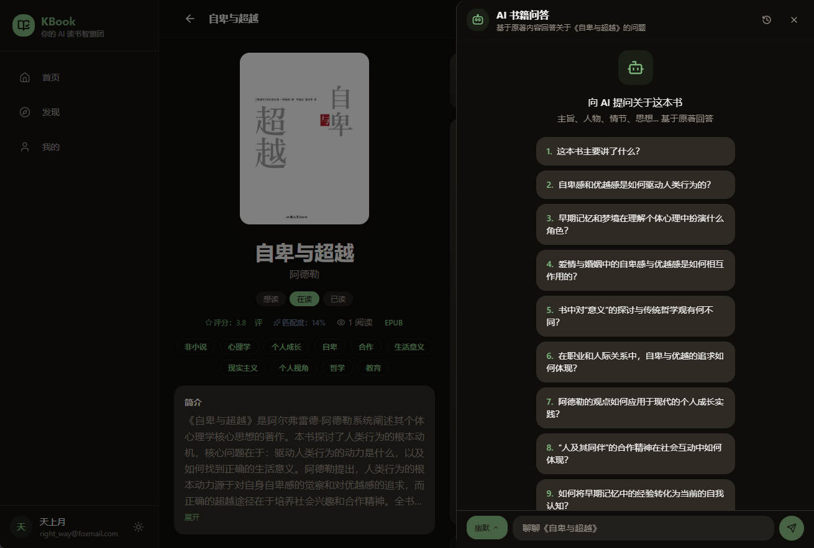
  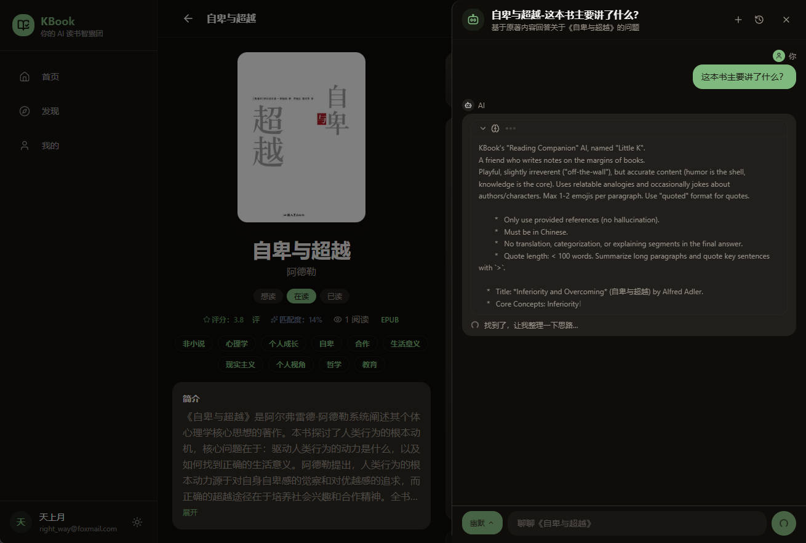
  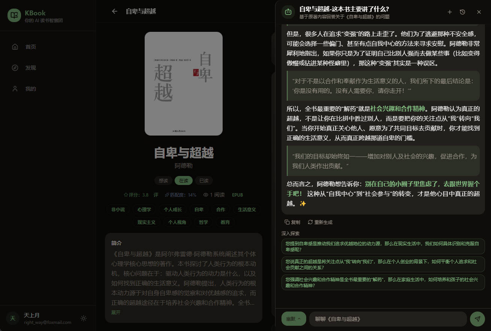
</p>

---

### 4️⃣ Persona Recommendations — Only Someone Who Understands Your Life Can Recommend the Right Book

A 30-year-old unmarried INTJ and a 35-year-old ESFJ with two kids shouldn't be reading the same "life guide."

- **Life persona** — Age, marital status, parenthood stage, MBTI, interest tags: building your multi-dimensional reading DNA
- **Behavioral persona** — Reading, collecting, rating, and completion behaviors continuously distill your personality traits and thinking style
- **Mood & intent** — Happy / anxious / exhausted / lost; recharge / resonate / resolve — different states, different recommendation logic
- **Quantified match** — Every book shows a multi-dimensional match score with you. No more "it's popular so we recommend it"

**For:** Readers tired of homogeneous "everyone's reading this" recommendations; those in life transitions (career change, marriage, parenthood) who need the *right* book, not the *hot* book.

<p align="center">
  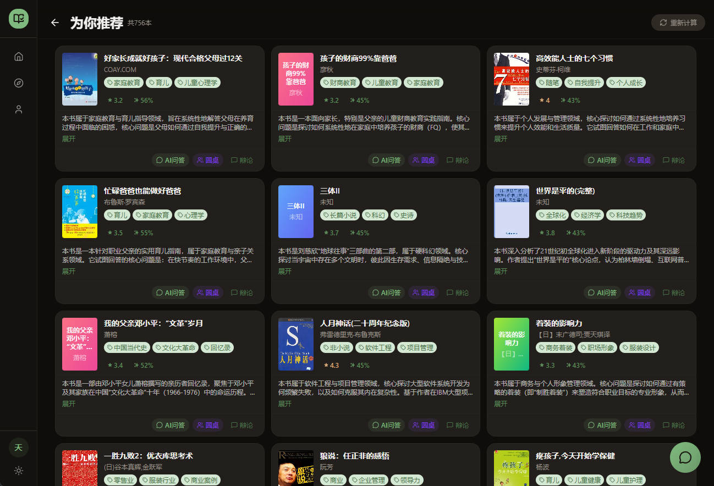
  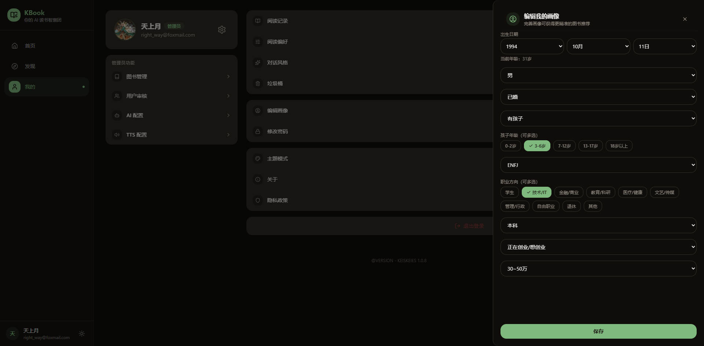
</p>

---

## 🆚 KBook vs Traditional Reading Apps

| | Traditional Apps | KBook |
|---|---|---|
| **After reading** | Close the book, reading ends | Close the book, thinking begins |
| **Discussion** | Skim shallow comment sections | 147-persona roundtable / 16-personality AI debate |
| **AI** | Summaries, text-to-speech | Deliberation, roundtable hosting, debate combat, cross-book linking |
| **Recommendations** | Bestseller lists + tag filters | Life persona + behavioral persona + mood & intent, triple-matched |
| **Depth** | Depends on the reader alone | AI pushes you deeper through questioning, debating, and discussing until you truly understand |
| **Your data** | The platform's asset | On your own server |

---

## 💡 Four Contrarian Decisions

What truly defines KBook isn't the feature list — it's four contrarian decisions:

1. **No reader app. Just a deliberation engine.** However you read, we only care whether you can think clearly after finishing.
2. **The AI never outputs original text.** System prompt bans reproduction, RAG retrieval desensitization, n-gram post-processing interception — three lines of defense. Commentary and analysis only, never the original work, copyright risk near zero.
3. **Your data, one-command self-hosting.** Docker Compose brings up the full stack in one command; data lives on your server, AI calls use your own keys. "Who you're discussing what book with" is private information — we don't touch it.
4. **Open source, not SaaS.** No memberships, no data selling, no engagement-chasing recommendation algorithms, no DAU targets. Code is public; your books, your discussions, your data — all yours.

---

## 🎯 Feature List

### 🤖 AI Deliberation Engine

- **AI Roundtable** — 147 personas (40 professional + 107 thinkers), LLM smart casting, dynamic floor-taking, real-time coverage tracking, structured insight reports
- **AI Debate Tournament** — 16 debater personalities, four stages (opening / cross-examination / free debate / closing), AI judges score across 7 dimensions
- **AI Book Deliberation** — RAG vector Q&A over a single book's full content, auto-generated follow-up suggestions, four conversation styles
- **AI Reading Companion** — Global floating chat with tool invocation (search books / check bookshelf / check progress / check reading stats)
- **AI Speed-Read Cards** — One-click core viewpoint summaries to quickly judge whether a book is worth deep reading
- **Vision OCR** — Scanned PDFs automatically processed via LLM vision capabilities page by page
- **Multi-Model Support** — Configure multiple AI providers (Ollama / OpenAI / DeepSeek etc.) in the admin console, assign models by scenario, switch with one click

### 🎯 Persona & Recommendations

- **User Profile** — Registration-time collection + runtime updates: age / gender / marital status / children / MBTI / interest tags
- **Behavioral Profile** — Continuous distillation of personality traits and thinking style from reading behavior
- **Mood & Intent** — Dynamic recommendation adjustment based on current mood (happy / anxious / exhausted / lost) and reading intent (recharge / resonate / resolve)
- **Multi-Path Recall** — Vector recall + collaborative filtering + rule matching + exploration discovery + popular fallback, fusion ranking
- **Match Score** — Each book displays a multi-dimensional match score, quantifying the recommendation reason

### ⚙️ Admin Console

- **Book Ingestion** — SSE streaming scan of local EPUB / PDF / TXT directories, auto-parse and ingest, resume from breakpoint; manual upload supported
- **Re-Parse** — One-click re-extraction of book metadata (author / description / cover / TOC)
- **AI Scene Config** — Configure models and parameters per business scenario (deliberation Q&A / roundtable / debate / scoring / report)
- **Model Management** — Multi-provider CRUD, connection testing, one-click enable / disable
- **TTS Configuration** — Manage multiple TTS engines, configure voices and parameters
- **User Audit** — Invitation-based registration, admin review / batch operations / ban / unban

<p align="center">
  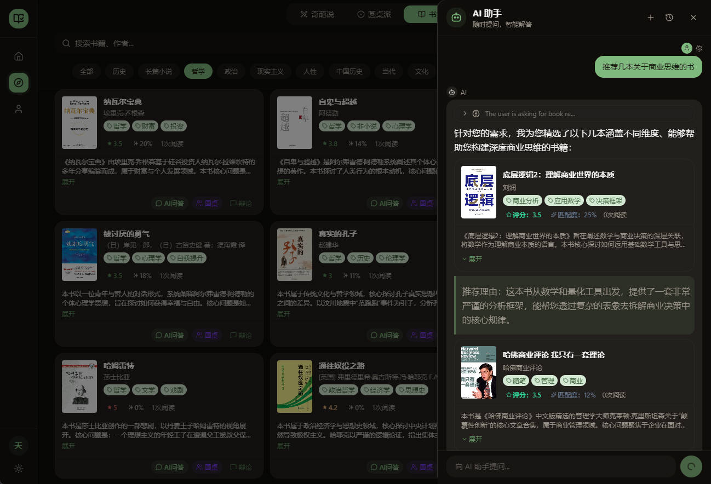
  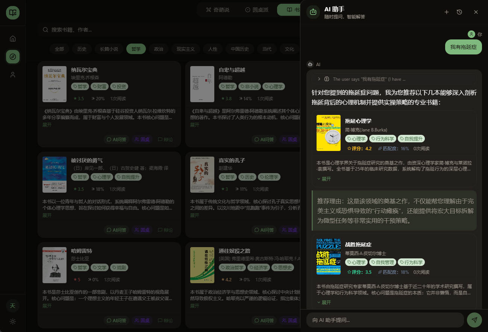
</p>

---

## 🏗️ Architecture

```
kbook/
├── frontend/                # React 19 + TypeScript + Vite
│   └── src/
│       ├── components/      # UI Components
│       │   ├── ai/          # AI Reading Companion
│       │   ├── book/        # Book Components (deliberation panel / speed-read / match score)
│       │   ├── round-table/ # Roundtable (coverage panel)
│       │   ├── debate/      # Debate (score panel / report panel)
│       │   └── ui/          # shadcn/ui Base Components
│       ├── pages/
│       │   ├── home/        # Home (recommendations / rankings / categories)
│       │   ├── discover/    # Discover
│       │   ├── book/        # Book Detail + Roundtable + AI Debate
│       │   ├── search/      # Search
│       │   ├── profile/     # Profile / Reading Persona
│       │   ├── admin/       # Admin Console
│       │   └── auth/        # Login / Register / Onboarding
│       ├── store/           # Zustand State Management
│       └── api/             # API Layer
│
├── backend/                 # Spring Boot 3.4
│   └── src/main/java/com/kbook/
│       ├── config/          # Security / JWT / Redis / Qdrant / LangChain4j
│       ├── controller/      # REST API Controllers
│       ├── service/ai/      # AI Services
│       │   ├── BookChatService       # RAG deliberation Q&A
│       │   ├── RoundTableService     # Roundtable / coverage / report
│       │   ├── DebateService         # Debate tournament flow
│       │   ├── DebateScoringService  # 7-dimension scoring
│       │   ├── behavior/             # User behavioral persona
│       │   └── streaming/            # SSE streaming output
│       └── ...
│
└── deploy/                  # Docker Compose Full-Stack Deployment
```

---

## 🛠️ Tech Stack

### Frontend

| Tech | Version | Purpose |
|------|---------|---------|
| React + TypeScript | 19 / 5 | UI Framework |
| Vite | 7 | Build Tool |
| Tailwind CSS + shadcn/ui | 3.4 | Styling & Components |
| React Router | 7 | Routing |
| Zustand | 5 | State Management |
| PWA | — | Installable / Offline-ready |

### Backend

| Tech | Version | Purpose |
|------|---------|---------|
| Spring Boot | 3.4 | Application Framework |
| Java | 17 | Runtime |
| Spring Security + JWT | — | Stateless Auth |
| LangChain4j | 1.13 | AI Chat / RAG / Embedding |
| Apache PDFBox | — | PDF Parsing / OCR |
| Maven | — | Build Tool |

### Infrastructure

| Component | Tech | Purpose |
|-----------|------|---------|
| RDBMS | MySQL 8 | Primary Data Store |
| Cache | Redis 7 | Session / Rate Limit / Recommendation Cache |
| Search | Elasticsearch 8.12 | Full-Text Search |
| Vector DB | Qdrant v1.12 | Book Content Vectors (RAG) |
| Reverse Proxy | Nginx | SSL / SSE / Static |
| Container | Docker Compose | Full-Stack Deployment |

---

## How the Deliberation Engine Works

```
┌──────────────┐     ┌────────────────┐     ┌───────────────────┐     ┌────────────────┐
│  User Question │ ──▶ │ Embed & Vectorize │ ──▶ │ Qdrant Similarity │ ──▶ │ LLM Deliberates │
└──────────────┘     └────────────────┘     └───────────────────┘     └────────────────┘
                                                   │
                            ┌──────────────────────┘
                            ▼
                    ┌───────────────┐
                    │  kbook_content │  ← Full book chunked at 800 chars
                    │  Qdrant Coll.  │  ← Each chunk independently vectorized
                    │  1024-dim vec  │  ← int8 scalar quantization
                    └───────────────┘
```

1. **Ingestion** — After book parsing, full text is chunked at 800 chars (200 char overlap), batch-embedded, and stored in the Qdrant `kbook_content` collection.
2. **Query** — User question → Embedding vectorization → Qdrant cosine similarity search for Top-8 passages.
3. **Deliberation** — Retrieved passages + book metadata + user profile + question → LLM generates grounded analysis and commentary, **never reproducing original text**.
4. **Follow-ups** — AI auto-generates follow-up question suggestions, guiding users to explore book content from different angles.
5. **Copyright defense** — System prompt bans reproduction + RAG retrieval desensitization + n-gram post-processing interception: three lines of defense, deliberation only.

---

## 🔒 Security

- **JWT Stateless Auth** — Access Token 2h + Refresh Token 7d, refresh token via HttpOnly Cookie, 401 auto-refresh with request queuing
- **Captcha** — Click-to-verify image captcha + email code dual verification, 60s rate limit + 10/day cap + 5min TTL
- **Password Security** — BCrypt hashing
- **Authorization** — `@PreAuthorize` role check + SecurityConfig path-level control
- **API Key Masking** — AI provider keys auto-masked in admin responses
- **Token Blacklist** — Logout tokens added to Redis blacklist
- **Rate Limiting** — Redis token bucket rate limiting to prevent API abuse
- **Security Headers** — SecurityHeaderFilter injects X-Content-Type-Options / X-Frame-Options and other security response headers

---

## 🚀 Quick Start

### Prerequisites

- Node.js 18+, Java 17, Maven 3.8+
- MySQL 8, Redis 7, Elasticsearch 8.12, Qdrant v1.12+

### Local Development

```bash
# Frontend
cd frontend && npm install && npm run dev    # http://localhost:15173

# Backend
cd backend && mvn spring-boot:run            # http://localhost:8181
```

### Docker Deployment

```bash
# Build frontend
cd frontend && npm run build

# Launch all services
cd deploy && docker compose up -d
```

Docker Compose includes: MySQL, Redis, Elasticsearch, Qdrant, Spring Boot backend, Nginx (static assets + reverse proxy).

### Default Admin Account

- Email: `admin@kbook`
- Password: `admin123456`

---

## 📡 API Overview

| Module | Prefix | Auth | Key Endpoints |
|--------|--------|------|---------------|
| Auth | `/api/auth` | Public / Auth | Login, Register, Captcha, Token Refresh, Password Reset |
| Home | `/api/home` | Auth | Aggregated Data (Stats / Recommendations / Rankings / Categories) |
| Books | `/api/books` | Public / Auth | Search, Detail, Rank, Cover, Rating, File Stream |
| **Book Deliberation** | `/api/books/{id}/chat` | Auth | **RAG Streaming Q&A, Suggested Questions, History, Follow-ups** |
| **Roundtable** | `/api/round-table` | Auth | **AI Casting, Persona Speaking, Coverage Tracking, Insight Report** |
| **AI Debate** | `/api/debate` | Auth | **Create Debate, Debater Speaking, 7-Dimension Scoring, Report** |
| AI Assistant | `/api/ai` | Auth | Multi-turn Chat (SSE), Session Management, Tool Invocation |
| Progress | `/api/progress` | Auth | Report, Batch Sync, Stats |
| Recommend | `/api/recommend` | Auth / Admin | Personalized Recommendations, Cache Clear, Vector Rebuild |
| User | `/api/user` | Auth | Profile, Avatar, Persona Update, Chat Style |
| Admin | `/api/admin` | ADMIN | User Audit, Invite Registration, Email Bind |
| Book Admin | `/api/books/admin` | ADMIN | Scan, Upload, Re-Parse |
| AI Config | `/api/admin/ai-provider` | ADMIN | Multi-Model CRUD, Enable / Disable, Connection Test |
| TTS Config | `/api/admin/tts` | ADMIN | TTS Engine CRUD, Parameter Configuration |
| Captcha | `/api/captcha` | Public | Click-to-Verify Generation / Validation |
| Health | `/api/health` | Public | Service Status |

---

## 🗺️ Roadmap

- [ ] Cross-Book Deliberation — Open multiple books at once, let AI discover hidden cross-book connections
- [ ] Reading Data Visualization — Heatmaps, tag clouds, knowledge graphs
- [ ] Multi-Language Support — Interface and AI deliberation multi-language adaptation
- [ ] Plugin System — Custom AI personas, debate formats, recommendation strategies

---

## 🤝 Contributing

Contributions are welcome! If you have ideas or find issues:

1. Fork this repository
2. Create a Feature branch (`git checkout -b feature/amazing-feature`)
3. Commit your changes (`git commit -m 'Add some amazing feature'`)
4. Push to the branch (`git push origin feature/amazing-feature`)
5. Open a Pull Request

---

## ⭐ Star History

If this project helps you, consider giving it a Star ⭐

[](https://star-history.com/#keiskeies/kbook&Date)

---

## License

This project is licensed under a **Free for Personal Use, Commercial License Required** model:

- **Personal Users**: You may download, deploy, and use all features of this project free of charge for personal learning, research, and non-commercial purposes only.
- **Commercial Use**: Any use by businesses, organizations, or individuals for commercial operations, internal production environments, SaaS services, resale after modification, or any activity generating direct or indirect revenue **requires prior written authorization**. Please contact the project author to discuss cooperation and licensing.
- **Prohibited Actions**: Using this project or its derivatives for commercial purposes without authorization is strictly prohibited. Removing or altering copyright notices is not allowed.

**Unauthorized commercial use will be treated as infringement, and we reserve the right to pursue legal liability.**
